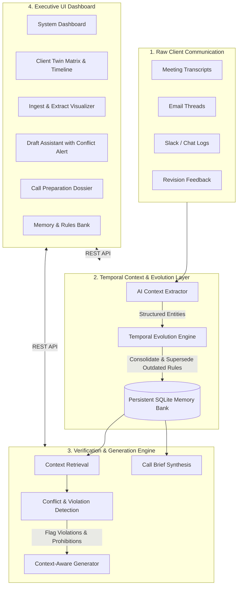

# ClientTwin AI — Dynamic Client Context Management Agent

> **Short Product Name:** ClientTwin AI  
> **Alternative Name:** Institutional Client-Twin System  
> **Core Concept:** A living, cumulative memory layer that retains client dialogue, evolves understanding over time when preferences change, flags policy/preference conflicts, and generates context-aware work.

---

## 🚀 System Architecture & Workflow

ClientTwin AI is **not a generic chatbot wrapper**. It implements a dedicated temporal reasoning and constraint verification pipeline:



---

## 🌟 Key Features

1. **Retain & Consolidate:**
   - Ingests raw transcripts, emails, and notes.
   - Extracts structured facts across 9 categories: *Preferences, Restrictions, Communication Style, Requirements, Brand Guidelines, Decisions, Priorities, Recurring Feedback, Important Facts*.

2. **Temporal Evolution (Superseding Logic):**
   - Automatically detects when a newer client preference contradicts or replaces an older one (e.g. *July: "Concise reports"* is superseded by *August: "Detailed data-driven reports"*).
   - Retains full provenance and historical timeline without losing audit trails.

3. **Active Conflict & Violation Warning Engine:**
   - When generating drafts, tests prompts against active client restrictions (e.g., prohibited buzzword `"synergy"` or preference for data-driven evidence over promotional hype).
   - Emits high-visibility alerts with rule provenance citations and automatically adjusts output.

4. **Context-Aware Drafting:**
   - Generates executive introductions, report summaries, and campaign briefs adhering strictly to the client's latest memory profile.

5. **Executive Call Preparation Dossier:**
   - 1-click synthesis of an 8-point call briefing sheet covering strategic priorities, active restrictions, recent changes, recurring feedback, open deliverables, and **critical pitfalls to avoid**.

6. **Instant Demo Mode:**
   - 1-click loader with preset July → August → September progression for Acme Corporation.

---

## 🛠 Tech Stack

- **Frontend:** React 18, TypeScript, Vite, Tailwind CSS, Lucide Icons
- **Backend:** Python 3.11+, FastAPI, Pydantic v2, Uvicorn
- **Persistence:** SQLite (`clienttwin.db`) with full transactional integrity
- **AI Engine:** Modular provider supporting **Google Gemini**, **OpenAI**, or **Intelligent Deterministic NLP Fallback Engine** (for zero-config demoing).

---

## ⚡ Quick Start Guide

### Prerequisites
- Python 3.10+
- Node.js 18+ and npm

### 1. Backend Setup

```bash
cd backend

# Create virtual environment (optional)
python -m venv venv
# On Windows:
.\venv\Scripts\activate
# On Linux/macOS:
source venv/bin/activate

# Install dependencies
pip install -r requirements.txt

# (Optional) Set API key in .env file:
# GEMINI_API_KEY=your_key_here
# or OPENAI_API_KEY=your_key_here
# If omitted, ClientTwin AI automatically runs in high-precision Demo AI Mode!

# Start the FastAPI server
uvicorn app.main:app --reload --port 8000
```

The backend will start at `http://localhost:8000`. API docs are available at `http://localhost:8000/docs`.

---

### 2. Frontend Setup

In a separate terminal:

```bash
cd frontend

# Install dependencies
npm install

# Start the Vite development server
npm run dev
```

Open your browser at **`http://localhost:5173`**.

---

## 🎬 Acme Corporation Demo Walkthrough

The application includes a built-in interactive demo scenario centered on **Acme Corporation**:

### Step 1: Initial Meeting (July 2026)
- **Input:** *"The client wants concise reports and does not want the word 'synergy' used in marketing materials. They prefer clear and straightforward communication."*
- **Memory Extracted:**
  - `Preference (Active)`: Concise reports
  - `Restriction (Active)`: Do not use "synergy"
  - `Communication Style (Active)`: Clear and straightforward

### Step 2: Follow-Up Meeting (August 2026)
- **Input:** *"Acme Corporation has changed its reporting preference. They now want more detailed, data-driven reports containing measurable results and statistics. The client still wants clear communication."*
- **Evolution Detected:**
  - `Preference (Superseded)`: Concise reports ➔ `Superseded by August Update`
  - `Preference (Active)`: Detailed, data-driven reports with measurable results
  - `Communication Style (Active)`: Clear and straightforward (retained)

### Step 3: Revision Feedback (September 2026)
- **Input:** *"The client does not want overly promotional language in campaign materials. They want claims to be supported by measurable evidence."*
- **New Constraints Added:**
  - `Restriction (Active)`: Avoid overly promotional language
  - `Requirement (Active)`: Support all claims with measurable evidence

### Step 4: Test Conflict & Context-Aware Generation
- Navigate to **Draft Assistant** (or click the yellow **Test Conflict Draft** button on the top bar).
- **Prompt:** *"Create a promotional introduction for Acme Corporation's campaign. Explain how our solutions create synergy between teams."*
- **System Actions:**
  1. Retrieves active client rules.
  2. Flags **2 High-Risk Conflicts**:
     - ⚠ Prohibited term `"synergy"` (July 2026 rule)
     - ⚠ Overly promotional tone violates September 2026 evidence mandate.
  3. Outputs a corrected, quantitative introduction replacing buzzwords with empirical metrics and cross-functional performance data.

### Step 5: Executive Call Preparation Dossier
- Click **Call Preparation** in the sidebar.
- Generate an 8-point briefing sheet for an upcoming meeting with Acme Corporation.

---

## 📡 API Endpoints

| Method | Endpoint | Description |
|---|---|---|
| `GET` | `/clients` | List all institutional clients |
| `GET` | `/clients/dashboard/stats` | Retrieve system KPIs and activity feed |
| `GET` | `/clients/{id}/twin` | Get full categorized twin overview & timeline |
| `GET` | `/clients/{id}/memory` | Query memories filtered by status (`active` / `superseded`) |
| `POST` | `/clients/{id}/ingest` | Ingest raw text, extract rules & compute evolution |
| `POST` | `/clients/{id}/draft` | Context retrieval, conflict warning & compliant drafting |
| `POST` | `/clients/{id}/call-brief` | Generate 8-point executive call prep briefing |
| `POST` | `/demo/load` | Reset database and load full 4-client demo scenario |
| `POST` | `/demo/set-acme-step` | Set Acme Corp state to Step 1, 2, or 3 for live demoing |

---

## 🔒 Security & Environment Variables

Create a `.env` file in `backend/`:

```env
# Optional LLM API Keys
GEMINI_API_KEY=
OPENAI_API_KEY=

# Server Configuration
PORT=8000
HOST=0.0.0.0
CLIENTTWIN_DB_FILE=clienttwin.db
```

---

## 🏆 Hackathon Submission Highlights

- **Pure End-to-End Working Prototype:** No mock placeholders—full REST API, database persistence, interactive frontend.
- **True Temporal Memory:** Distinguishes between Active and Superseded knowledge.
- **Visible Conflict Detection:** Intercepts account manager drafts before mistakes reach clients.
- **Enterprise UI Design:** Built with modern glassmorphism, responsive data cards, and interactive timeline visualization.
